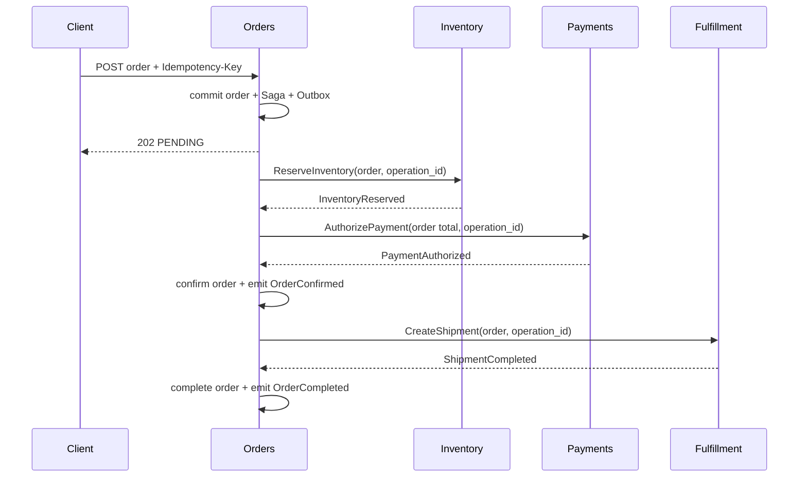

# Orders Saga Design

## Happy path

## Step policy

| Step | Command | Success fact | Transient failure | Permanent failure |
|---|---|---|---|---|
| Inventory | `ReserveInventory` | `InventoryReserved` | bounded retry | `InventoryRejected` → `FAILED` |
| Payment | `AuthorizePayment` | `PaymentAuthorized` | bounded retry | `PaymentFailed` → release inventory → `FAILED` |
| Fulfillment | `CreateShipment` | `ShipmentCreated`/`ShipmentCompleted` | bounded retry | refund payment → release inventory → `FAILED` |

Commands are written to Outbox only after the preceding local transition commits. A relay may publish duplicates; downstream operation IDs make them harmless.

When `PaymentAuthorized` is received, Orders verifies that the authorized amount and currency exactly match the immutable order quote. A mismatch is quarantined as a contract/integrity failure, prevents confirmation, and starts the documented compensation path; Orders never silently accepts a partial or differently denominated authorization.

## Compensation

Compensation is a first-class Saga phase, not an error log. Cancellation uses the original
`saga_id` and cancellation event as causation for release/refund commands. The order aggregate
durably records `inventory_released` and `payment_refunded`; `CANCELLED` is emitted only when
every required compensation fact has been received. An inventory rejection is treated as
"inventory already released" and a payment failure as "payment was not captured", so the
cancellation race cannot promote the order back to `CONFIRMED`.

The current implementation persists the compensation completion flags and Outbox commands.
Per-step retry/deadline repair state in `saga_steps`, and the `FAILED_REQUIRES_REVIEW` operator
workflow for `commerce.payment.refund_failed.v1`, remain explicit follow-up work. A refund
failure must be quarantined and reviewed; it is never acknowledged as a successful refund.

## Timeouts and ambiguous outcomes

A timeout means “unknown,” not “failed.” Orders retries the same deterministic operation and reconciles through the private lookup contract in [`orders-reconciliation.md`](orders-reconciliation.md) when needed. It never generates a fresh operation ID blindly after a timeout.

## Repair

Authorized repair replays a quarantined event or resumes a named Saga step after checking current order, Inbox, Outbox, and downstream operation state. Repair commands are audited, rate-limited, and cannot force arbitrary public status changes.
